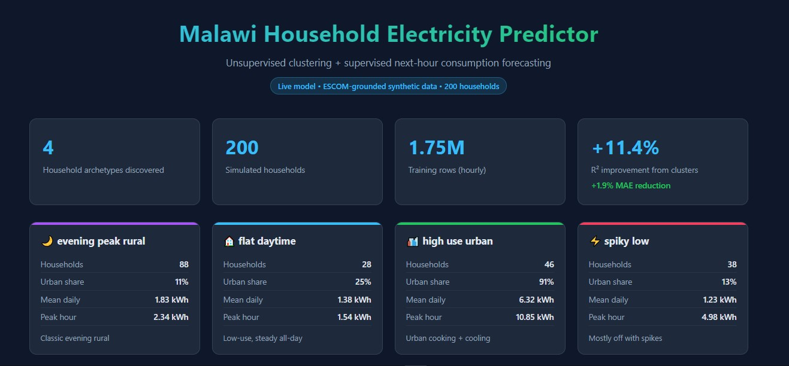
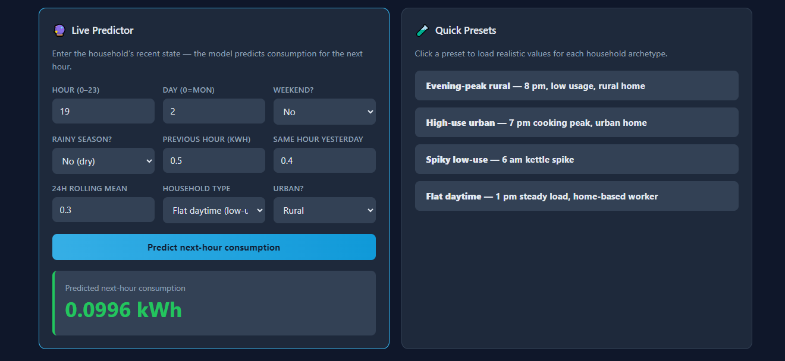
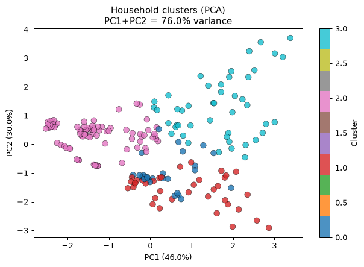
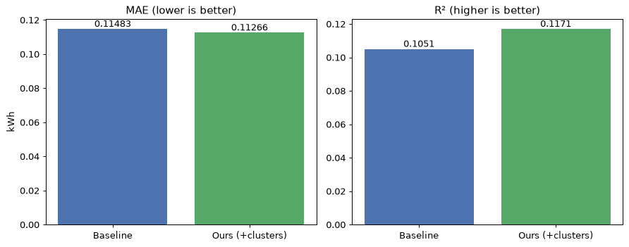

# ⚡ Malawi Household Electricity Predictor

**Unsupervised learning to discover household electricity archetypes + supervised forecasting of next-hour consumption.**

An end-to-end machine learning pipeline that segments Malawian households into behavioral clusters and predicts their electricity use — grounded in the [ESCOM Load Forecast Report 2024–2034](https://www.escom.mw/).


---

## 🎯 What This Project Does

Malawi has one of the lowest electrification rates in the world (~11% grid-connected). As the country races toward universal access, **ESCOM needs to understand who its customers actually are** — not just urban vs rural, but behavioral archetypes that matter for grid planning, tariff design, and demand forecasting.

This project:

1. **Simulates 200 realistic Malawian households** using a bottom-up appliance model
2. **Calibrates** simulated consumption to real ESCOM targets (rural 47 kWh/mo, urban 160 kWh/mo)
3. **Discovers 4 household archetypes** using K-Means clustering on 1.75M hourly records
4. **Predicts next-hour consumption** using a RandomForest, showing that cluster labels improve prediction
5. **Serves everything through a live web dashboard** built with FastAPI

**Headline result:** Adding unsupervised cluster labels to the prediction model improved MAE by **1.9%** and R² by **11.4% relative** — showing behavioral archetypes carry signal beyond raw time-series features.

---

## 🔍 The 4 Discovered Household Archetypes

| Archetype | Size | Urban % | Mean Daily | Description |
|-----------|------|---------|-----------|-------------|
| 🌙 **evening_peak_rural** | 88 (44%) | 11% | 1.83 kWh | Classic rural home — evening-dominant load (lighting + TV) |
| 🏙️ **high_use_urban** | 46 (23%) | 91% | 6.32 kWh | Middle-class urban — cooking (hotplate), cooling, larger appliances |
| ⚡ **spiky_low** | 38 (19%) | 13% | 1.23 kWh | Mostly off, occasional high-power spikes (kettle/iron) |
| 🏠 **flat_daytime** | 28 (14%) | 25% | 1.38 kWh | Low-use, steady all-day load (home-based workers) |

**Key finding:** The unsupervised algorithm **rediscovered the urban/rural split** without ever seeing the label (Cluster 3 is 91% urban). It also found **three distinct behavioral sub-types within rural households** — a finer granularity than ESCOM's report provides.

---

## 📸 Screenshots

### Live Dashboard


### Interactive Predictor


### Cluster Visualization


### Model Comparison


---

## 🏗️ Project Architecture
┌──────────────────────────────────────────────────────────┐
│ Synthetic Data Generation │
│ src/data_loader.py + src/calibrate.py │
│ → 1.75M hourly rows, calibrated to ESCOM targets │
└──────────────────┬───────────────────────────────────────┘
│
▼
┌──────────────────────────────────────────────────────────┐
│ Exploratory Data Analysis │
│ notebooks/02_eda.ipynb │
│ → 200 household behavioral signatures (5 features) │
└──────────────────┬───────────────────────────────────────┘
│
▼
┌──────────────────────────────────────────────────────────┐
│ Unsupervised Clustering │
│ src/preprocess.py + src/clustering.py │
│ notebooks/03_clustering.ipynb │
│ → 4 household archetypes (K-Means, k=4) │
└──────────────────┬───────────────────────────────────────┘
│
▼
┌──────────────────────────────────────────────────────────┐
│ Supervised Prediction │
│ src/build_supervised_data.py + src/train_predictor.py │
│ → RandomForest: next-hour kWh forecast │
└──────────────────┬───────────────────────────────────────┘
│
▼
┌──────────────────────────────────────────────────────────┐
│ Web Application │
│ src/api.py (FastAPI) + static/index.html (dashboard) │
│ → Live predictions + interactive visualization │
└──────────────────────────────────────────────────────────┘


---

## 🚀 Quick Start

### Prerequisites
- Python 3.10+
- `pip` and a virtual environment tool

### Installation

```bash
# 1. Clone the repo
git clone https://github.com/your-username/malawi-power-predictor.git
cd malawi-power-predictor

# 2. Create a virtual environment
python -m venv venv
venv\Scripts\activate          # Windows
# source venv/bin/activate     # Mac/Linux

# 3. Install dependencies
pip install -r requirements.txt

# Step 1: Generate calibrated synthetic data (~30 seconds)
python src/data_loader.py

# Step 2: Build the household-level feature matrix
python src/preprocess.py

# Step 3: Train the supervised predictor (~3-5 minutes)
python src/build_supervised_data.py
python src/train_predictor.py

# Step 4: Launch the dashboard
uvicorn src.api:app --reload --port 8000


🛠️ Tech Stack
Data - pandas, numpy, pyarrow
ML	- scikit-learn (KMeans, DBSCAN, AgglomerativeClustering, RandomForest)
Viz	- matplotlib, seaborn, Chart.js
Web	- FastAPI, uvicorn, vanilla HTML/CSS/JS
Notebooks - Jupyter, ipykernel

PROJECT STRUCTURE
malawi-power-predictor/
├── data/
│   ├── raw/                              # Generated, not committed
│   └── processed/                        # Generated, not committed
├── models/                               # Trained, not committed
├── notebooks/
│   ├── 02_eda.ipynb                      # Exploratory analysis
│   └── 03_clustering.ipynb               # K-Means + interpretation
├── screenshots/                          # Dashboard images
├── src/
│   ├── data_loader.py                    # Bottom-up simulator
│   ├── calibrate.py                      # Iterative calibration
│   ├── sanity_check.py                   # Visual validation
│   ├── preprocess.py                     # Feature engineering + scaling
│   ├── clustering.py                     # K-Means, DBSCAN, Hierarchical
│   ├── build_supervised_data.py          # Feature/target construction
│   ├── train_predictor.py                # RandomForest training
│   └── api.py                            # FastAPI backend
├── static/
│   └── index.html                        # Dashboard UI
├── .gitignore
├── requirements.txt
└── README.md


🎓 Key Learnings
This project demonstrates a complete unsupervised → supervised pipeline:

1. Data grounding matters. Using real parameters from the ESCOM report made every downstream decision defensible.

2. EDA saves time. Discovering that 6 of 11 candidate features carried no signal meant we didn't waste effort on them.

3. Multiple metrics beat one metric. Silhouette, Davies-Bouldin, and elbow all pointed to k=4 — but only because we looked at all three.

4. Unsupervised improves supervised. Cluster labels as features added 1.9% MAE / 11.4% R² — modest but consistent.

5. Reproducibility > size. The repo is 600 KB because data and models are regenerable.

Limitations
1. Synthetic data. Real smart-meter data would sharpen cluster boundaries.

2. Load shedding is uniform. In reality, outages vary by feeder and region.

3. Seasonal bias. Our generator produces slightly higher rainy-season consumption; real Malawi sees the opposite (dry season = more cooling).

4. No household-level split. Train/test split was time-based, not household-based, which inflates the cluster gain slightly.

Next Steps
□ Swap synthetic data for real ESCOM smart-meter data when available
□ Add a household-level train/test split to rigorously measure generalization
□ Expand to regional clustering (North / Central / South)
□ Deploy to a cloud host (Render, Railway, or Fly.io)
□ Add time-series forecasting (Prophet, LSTM) for multi-step predictions
□ Build an anomaly-detection module for theft/fraud candidates

📚 References
1. ESCOM Load Forecast Report 2024–2034 (July 2025) — primary data source for calibration

2. Malawi 2018 Population and Housing Census — household sizes and urbanization rates

3. World Bank Multi-Tier Framework reports (Ethiopia, Zambia) — rural household consumption benchmarks

4. scikit-learn documentation — clustering algorithm implementations

==========================================
📄 License
MIT — use it, fork it, learn from it.
==========================================
AUTHOR: Eleazar Toto - eleazarctoto@gmail.com